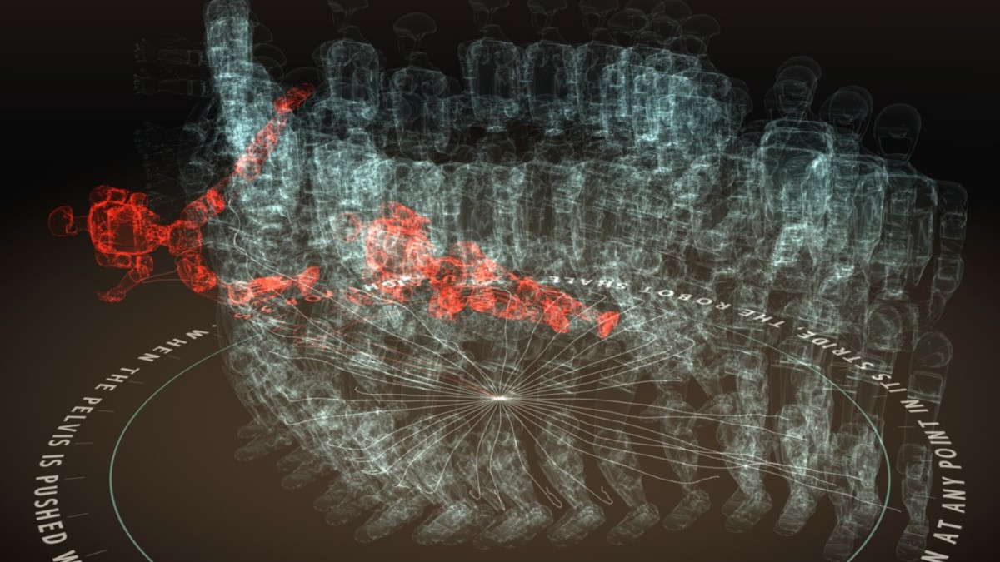

# GOLEM Night Watch

A Kiro Crew app from [GOLEM](https://github.com/RohanGlitched/golem) ([live site](https://d23v187fnxad7l.cloudfront.net), npm [`golem-spec`](https://www.npmjs.com/package/golem-spec)), which turns the EARS acceptance criteria of a Kiro spec into MuJoCo physics tests. This repository is the app on its own, with `app.json` at the root as Crew expects. The source of truth is [`skeleton/crew-app`](https://github.com/RohanGlitched/golem/tree/main/skeleton/crew-app) in the GOLEM repo.

A Kiro Crew app that looks for requirements your robot breaks while you sleep.

Every night at 03:00 it runs the `golem-skeptic` agent against the project's GOLEM requirements. The agent falsifies the requirements that held at their last run, then proposes a harsher but believable line for each one it can break. It writes proposals only through the `propose_requirement` tool. It never creates, edits or deletes a requirements file or a file under `controller/`. Each run ends with a summary in the run's output: the number of proposals and their requirement ids, the ids of requirements whose latest verdict is broken, and the budget used (trials run and wall time in seconds). If a run fails, the summary says what failed and how many proposals were written first.

A `held` verdict means no counterexample was found within the stated budget. It is not a proof.

## What is in the app

| Path | What it is |
|---|---|
| `app.json` | the manifest |
| `agents/golem-tuner.json`, `golem-skeptic.json`, `golem-scribe.json` | the three agents; copies of the GOLEM pack's agents (`skeleton/kiro-pack/agents` in the GOLEM repo) |
| `skills/robot-ears`, `skills/falsify-and-fix` | the two skills; copies of the GOLEM pack's skills |
| `assets/icon.png` | 512 x 512 PNG with transparent corners |
| `assets/screenshot-1.jpg` | 1200 x 675 (16:9) render of a falsification run |

The two images are generated in the GOLEM repo by `npm run crew:assets` in `skeleton/`. The screenshot is a crop of the GOLEM studio render, because the app has no dashboard page of its own.

## Requirements

The project must have `golem-spec` installed (`npm i -D golem-spec`), because the MCP server starts with `npx --no-install golem-spec mcp`, and at least one `.kiro/specs/*/requirements.md` with EARS lines.

## Network

`permissions.network` is `false`. The app makes no external network request: the MCP server and the MuJoCo simulation run on the machine that runs Crew. The nightly summary is text in the run's output. Writing it is not a network request.

## Manifest fields and where each comes from

Pages:

- **Manifest reference**: https://kiro.dev/docs/crew/apps/manifest/
- **Build your first app**: https://kiro.dev/docs/crew/apps/build-first-app/
- **Publishing and guidelines**: https://kiro.dev/docs/crew/apps/publishing/

### Fields kept

| Field | Value | Doc page |
|---|---|---|
| `name` | `golem-night-watch` (kebab-case) | Manifest reference (required fields and "Enforced at install time" regex); Publishing checklist (kebab-case, unique) |
| `version` | `0.1.0` (semver) | Manifest reference (required, "Enforced at install time"); Publishing (bump on update) |
| `displayName` | `GOLEM Night Watch` | Manifest reference (required) |
| `description` | one sentence | Manifest reference (required) |
| `author` | `Rohan Borade` | Manifest reference (optional metadata); Publishing checklist ("author is set") |
| `license` | `Apache-2.0` | Manifest reference (optional metadata) |
| `tags` | five discovery tags | Manifest reference (optional metadata); Publishing checklist ("tags help with discovery") |
| `repo` | `golem-night-watch` | Manifest reference (store listing: "Git repository name. Used by the blob proxy to serve images") |
| `iconPath` | `assets/icon.png` | Manifest reference (store listing); size and format from Publishing ("Assets": PNG with transparency, at least 256 x 256, square) |
| `screenshots` | `assets/screenshot-1.jpg` | Manifest reference (store listing, max 5); size from Publishing ("Assets": PNG or JPG, 1200 px wide, 16:9) |
| `highlights` | four bullets | Manifest reference (store listing, max 10) |
| `agents` | three paths, relative to the app root | Manifest reference (resources); Build your first app |
| `skills` | two skill directories | Manifest reference (resources); Build your first app |
| `mcpServers` | one `golem` server, `command` and `args` | Manifest reference (resources, "same format as mcp.json"; entries use `command` / `args` / `url` / `env`) |
| `crons[].name` | `night-watch` | Manifest reference (Crons table) |
| `crons[].cron_expr` | `0 3 * * *` | Manifest reference (Crons table; mutually exclusive with `every`); Build your first app (example with `cron_expr`) |
| `crons[].agent` | `golem-skeptic` | Manifest reference (Crons table, optional) |
| `crons[].message` | the nightly prompt | Manifest reference (Crons table: "Prompt sent to the agent on each run") |
| `permissions.network` | `false` | Manifest reference (Permissions table); Publishing checklist ("permissions are minimal") |

### Fields dropped or moved

| Previous field | Now | Reason (doc page) |
|---|---|---|
| `schedule` | `crons[]` | The Manifest reference defines no `schedule` field. Schedules are the `crons` array, which Crew registers on enable and deregisters on disable (Build your first app, "Crons"). |
| `schedule.cron` | `crons[].cron_expr` | Renamed to the documented field (Manifest reference, Crons table). |
| `schedule.agent` | `crons[].agent` | Same field name in the documented entry. |
| `schedule.prompt` | `crons[].message` | The documented name for the prompt sent on each run. |
| `schedule.timezone` | dropped | The Crons table has no time-zone field. The pages do not say which zone `cron_expr` is read in, so `0 3 * * *` is 03:00 on the clock of the machine running the gateway, as far as the docs show. |
| `permissions.cron` | dropped | The Manifest reference describes it as "Can create cron jobs", meaning cron jobs made at run time. Crons declared in `crons` need no permission (the `oncall-watchtower` example declares `crons` with only `api` and `events`), and Publishing asks for minimal permissions. |

### Documented fields this app does not use

`minKiroCrewVersion`, `jobFamilies`, `sops`, `heroImage*` (a missing hero falls back to the first screenshot, per the Manifest reference), `ui`, `backend`, `contributes`, `setup`, `dependencies`, `lifecycle`, `resources`, `platform`, `openCommand`. The app needs no dashboard page, backend process, install script or hero art. `permissions.api`, `events`, `mcpTools`, `storage`, `memory` and `jobs` are not declared because the app does not use them.

## Not verified against Crew

The three documentation pages do not define the agent JSON schema or the skill front matter beyond one sample each (Build your first app). The agents here are Kiro CLI agent files, checked with `kiro-cli agent validate`; the skills carry `name` and `description` front matter. No Crew gateway was available to install the app, so `kirocrew doctor` and the install call in Publishing have not been run against it.
